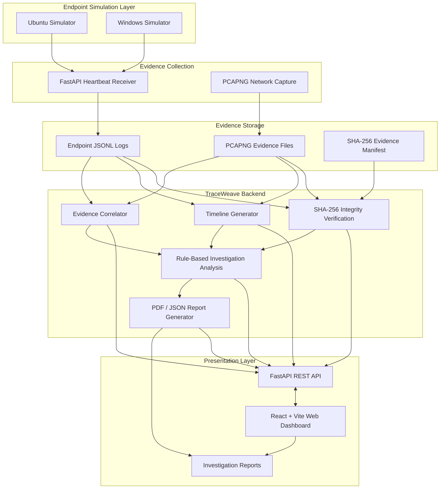

# TraceWeave

### An Integrity-Verified Platform for Correlating Endpoint Telemetry and Network Evidence

**Connect the evidence. Reveal the story.**

TraceWeave is an academic cybersecurity investigation-support platform designed to collect endpoint telemetry, analyze network traffic, correlate digital evidence, verify evidence integrity, and generate structured investigation reports.

It provides a centralized interface for investigating network activity across simulated Linux and Windows endpoints.

---

## Overview

Modern cybersecurity investigations often require analysts to examine multiple sources of digital evidence, including endpoint logs and network packet captures.

TraceWeave addresses this challenge by bringing endpoint telemetry and network evidence into a unified investigation workflow.

The platform receives endpoint heartbeat events, processes PCAPNG network captures, correlates related observations, constructs a chronological investigation timeline, and verifies evidence integrity using SHA-256 hashes.

The resulting investigation data can be reviewed through a web dashboard and exported as PDF or JSON reports.

## Key Features

- **Endpoint Telemetry Collection:** Receives heartbeat events from simulated Ubuntu and Windows endpoints.
- **Network Evidence Processing:** Parses PCAPNG packet captures using TShark.
- **Evidence Correlation:** Matches endpoint and network observations using source IP addresses and timestamps.
- **Chronological Timeline:** Combines endpoint events, network observations, and correlation results.
- **Evidence Integrity Verification:** Uses SHA-256 hashes and evidence manifests to identify verified, modified, or missing evidence.
- **Investigation Analysis:** Applies rule-based analysis to identify findings and assign investigation priorities.
- **Report Generation:** Generates structured PDF and JSON investigation reports.
- **Web Dashboard:** Provides a centralized interface for accessing investigation information.

---

## System Architecture

TraceWeave follows a client-server architecture with separate endpoint simulators, a backend processing service, evidence storage, and a web frontend.

### Architecture Diagram



### Architecture Layers

| Layer | Responsibility |
|---|---|
| Endpoint Simulation | Generates endpoint heartbeat telemetry |
| Evidence Collection | Receives heartbeat events and stores network captures |
| Evidence Processing | Parses and correlates collected evidence |
| Integrity Verification | Checks evidence against SHA-256 manifests |
| Investigation Analysis | Generates rule-based findings and priorities |
| Report Generation | Produces PDF and JSON reports |
| Presentation | Displays investigation information through the web dashboard |

---

## Investigation Workflow

1. **Endpoint Simulation:** Ubuntu and Windows simulators generate heartbeat events.
2. **Telemetry Collection:** The FastAPI backend receives heartbeat requests and records them in JSONL logs.
3. **Network Capture:** Network activity is captured and stored in PCAPNG format.
4. **Packet Parsing:** TShark extracts relevant packet information from the network capture.
5. **Evidence Correlation:** The correlator compares endpoint records and network observations using source IP and timestamp information.
6. **Timeline Construction:** Related endpoint and network events are arranged chronologically.
7. **Integrity Verification:** SHA-256 hashes are compared with the evidence manifest.
8. **Investigation Analysis:** Rule-based logic evaluates the available investigation evidence.
9. **Report Generation:** The platform produces downloadable PDF and JSON reports.

---

## Technology Stack

| Component | Technology |
|---|---|
| Backend | Python, FastAPI |
| Frontend | React, TypeScript |
| Frontend Build Tool | Vite |
| Network Analysis | TShark |
| Evidence Storage | JSONL, PCAPNG |
| Integrity Verification | SHA-256 |
| Reporting | ReportLab, JSON |
| Operating System | Kali Linux |
| Endpoint Simulators | Ubuntu Linux, Windows |
| Version Control | Git and GitHub |

---

## Project Structure

```text
attacker-investigation-lab/
│
├── backend/
│   ├── main.py
│   │
│   ├── services/
│   │   ├── case_manager.py
│   │   ├── correlator.py
│   │   ├── evidence_integrity.py
│   │   ├── investigation_analysis.py
│   │   ├── pcap_parser.py
│   │   ├── report_generator.py
│   │   └── timeline.py
│   │
│   ├── make_demo_case.py
│   └── test_*.py
│
├── frontend/
│   ├── public/
│   ├── src/
│   │   ├── assets/
│   │   ├── pages/
│   │   │   ├── Dashboard.tsx
│   │   │   ├── LandingPage.tsx
│   │   │   └── ReportsPage.tsx
│   │   ├── App.tsx
│   │   ├── App.css
│   │   └── index.css
│   │
│   ├── package.json
│   └── vite.config.ts
│
├── evidence/
│   ├── logs/
│   ├── pcaps/
│   └── cases/
│
├── .gitignore
└── README.md
```

*Note: The evidence directory contains local investigation data and is excluded from the GitHub source repository.*

---

## Installation and Setup

### Requirements

- Kali Linux or another compatible Linux environment
- Python 3
- Node.js and npm
- TShark
- Git
- Ubuntu and/or Windows endpoint simulator environments

### 1. Clone the Repository

```bash
git clone git@github.com:ThmiD89/TraceWeave.git
cd TraceWeave
```

### 2. Set Up the Python Environment

```bash
python3 -m venv .venv
source .venv/bin/activate
```

Install the backend dependencies listed in your project's dependency file.

### 3. Start the Backend

```bash
cd backend
source ../.venv/bin/activate
uvicorn main:app --host 0.0.0.0 --port 8000
```

Backend API:

`http://127.0.0.1:8000`

Interactive API documentation:

`http://127.0.0.1:8000/docs`

### 4. Start the Frontend

Open another terminal:

```bash
cd frontend
npm install
npm run dev -- --host 0.0.0.0
```

Frontend:

`http://127.0.0.1:5173`

### 5. Start the Endpoint Simulators

On the Ubuntu simulator:

```bash
cd ~/heartbeat-simulator
python3 heartbeat.py
```

On the Windows simulator, open PowerShell:

```powershell
cd C:\Users\TAMZID\windows-telemetry
python windows_heartbeat.py
```

Ensure the simulator's configured backend address points to the Kali machine's reachable IP address.

**Important:** Configure the backend and frontend addresses for your own network. The lab IP addresses used during development are not universal.

---

## API Overview

The backend exposes REST API endpoints for telemetry collection and investigation operations.

| Endpoint | Method | Purpose |
|---|---|---|
| `/` | GET | Backend service status |
| `/heartbeat` | POST | Receive endpoint heartbeat |
| `/heartbeats` | GET | Retrieve collected heartbeat records |
| `/docs` | GET | Interactive API documentation |
| `/cases/{case_id}/analysis` | GET | Retrieve investigation analysis |
| `/cases/{case_id}/reports/json` | GET | Download JSON investigation report |
| `/cases/{case_id}/reports/pdf` | GET | Download PDF investigation report |

Additional case-management and evidence-related endpoints are implemented in the backend.

---

## Evidence Integrity

TraceWeave incorporates an evidence integrity verification mechanism based on SHA-256 cryptographic hashes.

Evidence files are checked against their recorded manifest information.

The verification process identifies three primary conditions:

| Status | Meaning |
|---|---|
| VERIFIED | Evidence matches the recorded manifest |
| MODIFIED | Evidence differs from its recorded integrity information |
| MISSING | Expected evidence file cannot be found |

This mechanism helps identify changes to stored investigation evidence.

---

## Evidence Correlation

TraceWeave correlates endpoint heartbeat records with parsed network observations.

The current correlation implementation uses:

- Source IP address matching
- Timestamp comparison
- A five-second matching window
- One-to-one use of endpoint records
- Correlation confidence classification

Correlation results are classified as HIGH or MEDIUM confidence.

Unmatched network observations are retained for further review. An unmatched observation alone does not establish malicious activity.

---

## Investigation Reports

TraceWeave supports PDF and JSON report generation.

The report includes:

1. Case Information
2. Investigation Assessment
3. Investigation Findings
4. Network Correlation Summary
5. Individual Correlation Records
6. Unmatched Packet Details
7. Chronological Investigation Timeline
8. Evidence Integrity Results
9. Detailed Evidence Verification
10. Classification Disclaimer

Reports provide a structured overview of the available evidence and investigation results.

---

## Screenshots

### 1. Landing Page


### 2. Investigation Dashboard


### 3. Ubuntu Endpoint Simulator


### 4. Windows Endpoint Simulator


### 5. Investigation Reports


---

## Testing

The backend includes tests covering major investigation components, including:

- Case management
- Network evidence parsing
- Evidence correlation
- Timeline generation
- Evidence integrity verification
- Manifest creation
- Report generation
- Evidence modification scenarios

Run the backend tests from the backend directory:

```bash
cd backend
pytest
```

Ensure the required Python test dependencies are installed.

---

## Project Scope and Limitations

TraceWeave is an academic cybersecurity investigation-support prototype.

Its current implementation has the following limitations:

- Endpoint telemetry is based on simulated heartbeat events.
- Correlation relies on source IP addresses and a timestamp matching window.
- Rule-based findings do not constitute definitive attack detection.
- Correlation confidence is not a statistically calibrated probability.
- Evidence integrity verification depends on the trustworthiness of the original manifest.
- Results require human interpretation and investigation.

TraceWeave is not intended to replace a production SIEM, EDR, forensic investigation suite, or professional incident-response platform.

---

## Academic Purpose

This project explores the practical application of:

- Network traffic analysis
- Endpoint telemetry collection
- Digital evidence management
- Event correlation
- Chronological event reconstruction
- Cryptographic integrity verification
- Cybersecurity investigation reporting
- Full-stack application development

It was developed as an academic cybersecurity engineering project using an authorized virtual lab environment.

---

## Future Improvements

Potential future development areas include:

- Configurable endpoint registration
- Improved event correlation mechanisms
- More advanced investigation visualization
- Additional endpoint telemetry sources
- Investigation case export and import
- Enhanced evidence chain-of-custody records
- Configurable network and backend settings
- Expanded automated testing

These are potential improvements, not claims about currently implemented features.

---

## Author

**ThmiD89**

Cyber Security Engineering

Academic Cybersecurity Project

## License

No open-source license has currently been selected. All rights reserved unless a license is added to this repository.

---

<p align="center">
  **TraceWeave**
  <br/>
  Connect the evidence. Reveal the story.
</p>
